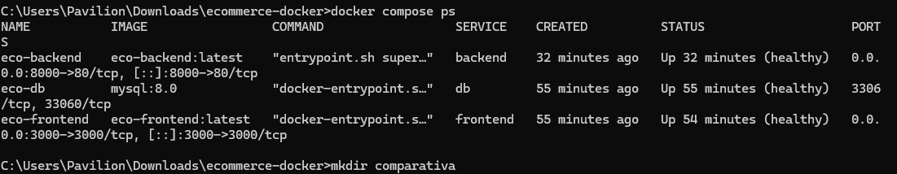
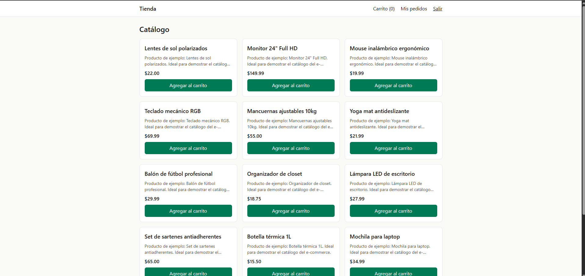
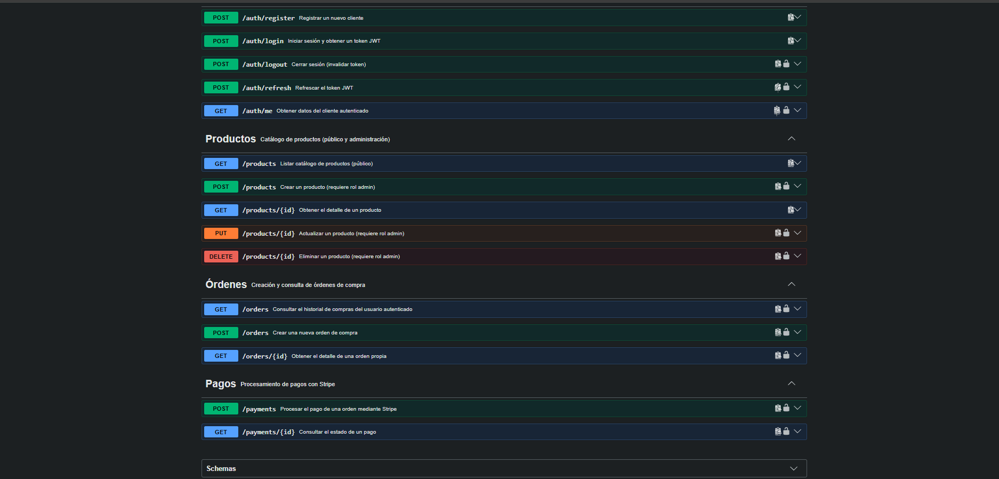
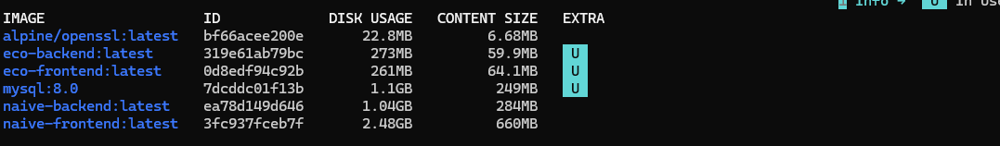

# E-commerce en producción con Docker: Next.js 16 + Laravel 12 + MySQL 8

Ecosistema de tres servicios contenerizado con **Dockerfiles multi-stage**, capas optimizadas para caché, usuarios sin privilegios y orquestación con un solo comando (`docker compose up`).

- **Frontend:** tienda en Next.js 16 (App Router, TypeScript, Tailwind). Server Components + Server Actions, token JWT en cookie `httpOnly`.
- **Backend:** API REST en Laravel 12 con JWT (`php-open-source-saver/jwt-auth`), pagos con Stripe y documentación Swagger (`l5-swagger`).
- **Base de datos:** MySQL 8.0 con volumen persistente.

## Arquitectura de contenedores

```
        Navegador
      :3000 │   │ :8000 (API + Swagger)
            ▼   ▼
 ┌──────────── frontend_net ────────────┐
 │ [frontend] Next.js (node:20-alpine)  │
 │      │ BASE_URL=http://backend/api   │
 │      ▼                               │
 │ [backend] Nginx + PHP-FPM 8.3 ───────┼──┐
 └──────────────────────────────────────┘  │ backend_net (interna)
                                           ▼
                              [db] MySQL 8.0 (volumen db_data)
                              3306 NO expuesto al host
```

| Servicio | Imagen base | Puerto host | Notas |
|---|---|---|---|
| `frontend` | `node:20-alpine` | 3000 | Salida `standalone`, usuario `nextjs` |
| `backend` | `php:8.3-fpm-alpine` | 8000 → 80 | Nginx proxy inverso → PHP-FPM (supervisord) |
| `db` | `mysql:8.0` | ninguno | Volumen persistente + healthcheck |

El frontend llama a la API **desde el servidor** (Server Components y Server Actions) por la red interna (`http://backend/api`). El navegador solo habla con el frontend, salvo para Swagger (`:8000`). Dos redes aíslan los servicios: la base de datos solo es alcanzable por el backend.

## Estructura del repositorio

```
.
├── docker-compose.yml
├── .env.example             # variables documentadas
├── frontend/                # Next.js + Dockerfile + .dockerignore
├── backend/                 # Laravel + Dockerfile + .dockerignore + docker/ (nginx, php, supervisor)
├── db/init/                 # SQL de inicialización (opcional)
├── comparativa/             # Dockerfiles sin optimizar, solo para medir
└── evidencias/              # capturas de funcionamiento
```

## Cómo ejecutarlo

Requisitos: Docker Desktop y Git.

```bash
git clone <URL_DE_ESTE_REPO>
cd <carpeta>
cp .env.example .env        # en Windows CMD: copy .env.example .env
```

Edita `.env` y completa:

| Variable | Cómo obtenerla |
|---|---|
| `APP_KEY` | `docker run --rm alpine/openssl rand -base64 32` y anteponer `base64:` |
| `JWT_SECRET` | `docker run --rm alpine/openssl rand -base64 64` (en una sola línea) |
| `MYSQL_ROOT_PASSWORD`, `MYSQL_PASSWORD` | Contraseñas a elección |
| `MYSQL_DATABASE` | `ecommerce_api` (debe coincidir con `db/init/01-init.sql`) |
| `STRIPE_KEY`, `STRIPE_SECRET` | Claves de prueba en https://dashboard.stripe.com/test/apikeys |

Levanta todo:

```bash
docker compose up -d --build
docker compose ps            # db, backend y frontend deben quedar "healthy"
```

Carga los productos de ejemplo (la base de datos empieza vacía):

```bash
docker compose exec backend php artisan db:seed --class=ProductSeeder --force
```

Accesos:

- Frontend: http://localhost:3000
- API: http://localhost:8000/api/products
- Swagger: http://localhost:8000/api/documentation
- Usuario de prueba: `cliente@ecommerce.test` / `Cliente123!`

Comandos útiles: `docker compose logs -f backend` · `docker compose down` (conserva datos) · `docker compose down -v` (borra el volumen).

## Decisiones técnicas

### Frontend (Next.js)
- **3 etapas (`deps` → `builder` → `runner`)**: compiladores, TypeScript, Tailwind y `devDependencies` no llegan a la imagen final.
- **Caché de capas**: `package*.json` se copia solo y antes del código; `npm ci` solo se reejecuta si cambian las dependencias. Además `--mount=type=cache` reutiliza la caché de npm entre builds.
- **`output: "standalone"`** (en `next.config.ts`): Next traza solo las dependencias usadas y genera `server.js`, el equivalente optimizado de `next start`. Evita copiar todo `node_modules`.
- **`BASE_URL` en runtime**: `lib/config.ts` la lee en el servidor, así que la misma imagen sirve para cualquier entorno y no se incrusta en el bundle. Todas las rutas son dinámicas, por lo que el build no necesita la API disponible.
- **Seguridad**: usuario no root, `NODE_ENV=production`, telemetría desactivada, `HEALTHCHECK`.

### Backend (Laravel)
- **Etapa `vendor` con `composer:2`**: Composer y sus herramientas no existen en la imagen final; solo se copia `vendor/` optimizado (`--no-dev`, `--classmap-authoritative`).
- **Caché de capas**: `composer.json` y `composer.lock` se copian antes que el código.
- **PHP 8.3 en lugar de 8.2**: el `composer.lock` del proyecto incluye dependencias que exigen PHP >= 8.3 (Composer lo valida en `platform_check.php` y la app no arranca con 8.2). El enunciado pide PHP 8.2+.
- **Extensiones**: `pdo_mysql`, `mbstring`, `xml`, `ctype`, `tokenizer` con `install-php-extensions` (limpia dependencias de compilación). `openssl` y `json` ya vienen compiladas en la imagen oficial y el build lo valida con `php -m`. Se añade `opcache`.
- **Nginx + PHP-FPM en un contenedor** con `supervisord`, para mantener los tres servicios pedidos. Alternativa más pura: un contenedor por proceso.
- **`clear_env = no`**: PHP-FPM recibe las variables del contenedor (JWT, Stripe, DB); ningún secreto queda en la imagen.
- **Entrypoint**: cachea config y vistas en runtime y ejecuta migraciones si `RUN_MIGRATIONS=true`. `route:cache` se intenta pero no es crítico, porque `routes/web.php` usa closures.
- **Sin dependencias de desarrollo**: por eso `db:seed` completo falla (Faker es `require-dev`); se usa `--class=ProductSeeder`, que no depende de factories.
- **Swagger** se regenera al arrancar (`L5_SWAGGER_GENERATE_ALWAYS`); `storage/api-docs` es escribible por `www-data`.
- Logs a stderr; el `.dockerignore` excluye `.env`, `vendor` local y `tests`.

### Base de datos (MySQL)
- Imagen oficial `mysql:8.0`, configurada con `MYSQL_ROOT_PASSWORD`, `MYSQL_DATABASE`, `MYSQL_USER` y `MYSQL_PASSWORD`.
- **Volumen nombrado `db_data`** en `/var/lib/mysql`.
- `./db/init` montado en `/docker-entrypoint-initdb.d/` (solo lectura).
- **Sin `ports`**: 3306 queda dentro de la red interna.
- **Healthcheck** + `depends_on: service_healthy`: las migraciones no corren antes de que MySQL esté listo.

### Reproducibilidad
`npm ci` y `composer.lock` fijan versiones; el `.env` real está en `.gitignore`; la misma imagen funciona en cualquier entorno cambiando solo variables.

## Resultados de optimización

Medido con `docker images` (columna DISK USAGE). Las versiones "sin optimizar" están en `comparativa/` y representan el enfoque inicial: una sola etapa, imagen base completa (`node:20`, `php:8.3-fpm`) y herramientas de build dentro de la imagen final.

| Imagen | Sin optimizar | Con multi-stage | Reducción |
|---|---|---|---|
| Frontend (Next.js) | 2,48 GB | 261 MB | 89,5 % |
| Backend (Laravel) | 1,04 GB | 273 MB | 73,8 % |

Tamaño comprimido (CONTENT SIZE, lo que se transfiere al subir o bajar la imagen):

| Imagen | Sin optimizar | Con multi-stage | Reducción |
|---|---|---|---|
| Frontend (Next.js) | 660 MB | 64,1 MB | 90,3 % |
| Backend (Laravel) | 284 MB | 59,9 MB | 78,9 % |

### Qué explica la reducción
- **Frontend:** la imagen final no contiene `node_modules` completo, `devDependencies`, TypeScript ni Tailwind; solo el servidor `standalone`, los estáticos y `public/`. Además parte de `node:20-alpine` en lugar de `node:20`.
- **Backend:** la imagen final no incluye Composer, git ni unzip, no instala paquetes de desarrollo (`--no-dev`) y usa `php:8.3-fpm-alpine`. Solo se copia `vendor/` ya optimizado.

### Reproducir la comparación
```bash
docker build -f comparativa/Dockerfile.frontend.naive -t naive-frontend frontend
docker build -f comparativa/Dockerfile.backend.naive -t naive-backend backend
docker images
```

## Evidencias

**Contenedores en ejecución (`healthy`); MySQL sin puerto publicado al host**



**Catálogo en el frontend consumiendo la API y MySQL**



**API documentada con Swagger**



**Comparación de tamaños de imágenes (optimizadas vs. sin optimizar)**


